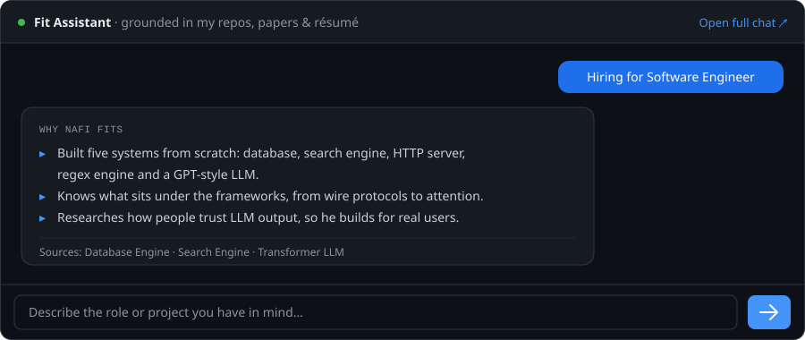

<!-- Profile README · draft-3
     Placeholders are in [square brackets]. Search for "[" and "TODO" to fill them in. -->

  

## Toolbox

  

## Projects & Research

  
  
  
  
  

### LLM & ML

<table>
<tr>
<td width="60%" valign="top">
<b>LLM &amp; ML · FLAGSHIP</b>
<h3><a href="https://github.com/nafiulkhalid/Transformer_LLM">Transformer LLM</a></h3>
GPT-style transformer written from scratch (tokenizer, attention, training loop), served through a streaming FastAPI + React chat UI.
  
<code>PyTorch</code> <code>FastAPI</code> <code>React</code>
  
<a href="https://github.com/nafiulkhalid/Transformer_LLM">Repo</a> · <a href="#">Demo</a> · <a href="#">Write-up</a>
</td>
<td width="40%" valign="top">
<h1>[n] tok/s</h1>
Throughput on [hardware]
</td>
</tr>
</table>

### Systems

<table>
<tr>
<td width="50%" valign="top">
<b>SYSTEMS</b>
<h3><a href="https://github.com/nafiulkhalid/Search_Engine">Search Engine</a></h3>
Vector-space search with TF-IDF ranking on a self-built Redis-compatible store.
<h3>[n] ms</h3>
p50 · [n] docs
  
<code>Python</code> <code>RESP</code> <code>React</code>
  
<a href="https://github.com/nafiulkhalid/Search_Engine">Repo</a> · <a href="#">Demo</a> · <a href="#">Write-up</a>
</td>
<td width="50%" valign="top">
<b>SYSTEMS</b>
<h3><a href="https://github.com/nafiulkhalid/Database_Engine">Database Engine</a></h3>
Persistent key-value store with its own wire protocol and a live metrics dashboard.
<h3>[n]k ops/s</h3>
[n] ms latency
  
<code>Python</code> <code>Sockets</code> <code>React</code>
  
<a href="https://github.com/nafiulkhalid/Database_Engine">Repo</a> · <a href="#">Demo</a> · <a href="#">Write-up</a>
</td>
</tr>
<tr>
<td width="50%" valign="top">
<b>SYSTEMS</b>
<h3><a href="https://github.com/nafiulkhalid/Regex_Engine">Regex Engine</a></h3>
Backtracking, NFA and DFA matchers built from automata theory.
<h3>[n]×</h3>
DFA vs backtracking
  
<code>Python</code> <code>Automata</code>
  
<a href="https://github.com/nafiulkhalid/Regex_Engine">Repo</a> · <a href="#">Demo</a> · <a href="#">Write-up</a>
</td>
<td width="50%" valign="top"></td>
</tr>
</table>

### Research

<table>
<tr>
<td width="50%" valign="top">
<b>RESEARCH · PAPER</b>
<h3>[Paper title]</h3>
[One- or two-line finding of the study.]
<h3>[n]</h3>
participants · [Venue Year]
  
<code>User study</code> <code>Python</code>
  
<a href="#">PDF</a> · <a href="#">Code</a> · <a href="#">Talk</a>
</td>
<td width="50%" valign="top">
<b>RESEARCH · POSTER</b>
<h3>[Poster title]</h3>
[One- or two-line summary of the work.]
<h3>[n]</h3>
[key result] · [Venue Year]
  
<code>HCI</code> <code>LLMs</code>
  
<a href="#">Poster</a> · <a href="#">Code</a>
</td>
</tr>
</table>

### Infra

<table>
<tr>
<td width="50%" valign="top">
<b>INFRA</b>
<h3><a href="https://github.com/nafiulkhalid/REST_API_Server">REST API Server</a></h3>
HTTP handling and a CRUD client written without framework magic.
<h3>[n] req/s</h3>
under load
  
<code>Python</code> <code>HTTP</code>
  
<a href="https://github.com/nafiulkhalid/REST_API_Server">Repo</a> · <a href="#">Demo</a> · <a href="#">Write-up</a>
</td>
<td width="50%" valign="top"></td>
</tr>
</table>

## What are you looking for? Ask my AI.

Tell it what you're hiring for or building. It answers from my real projects and research, nothing invented.

<!-- TODO: host the chat at nafiulkhalid.com/fit; each tile opens it with the question pre-filled -->

  

  
  
   
  
  

Answers are generated from my projects and papers. [Privacy / "AI can make mistakes" note]

### Let's Find a Time

---

  <a href="https://nafiulkhalid.com">nafiulkhalid.com</a> &nbsp;·&nbsp;
  <a href="https://www.linkedin.com/in/nafiulkhalid/">LinkedIn</a> &nbsp;·&nbsp;
  <a href="mailto:nkhal014@fiu.edu">Email</a> &nbsp;·&nbsp;
  <a href="https://orcid.org/0009-0002-1916-6863">ORCID</a>

