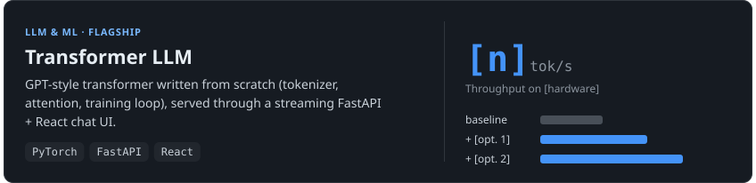
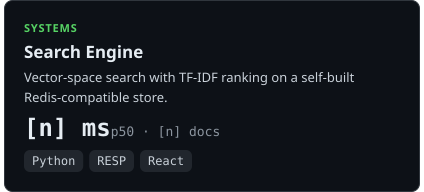
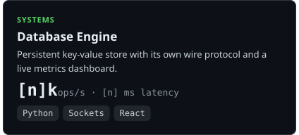
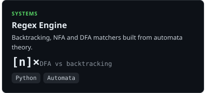
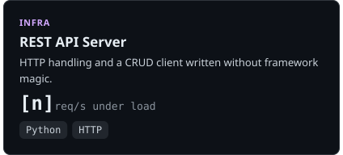
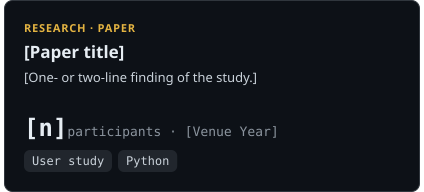
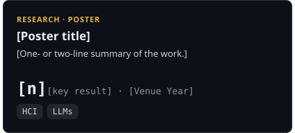

  

## Toolbox

  

## Projects & Research

 

 

 

 

## Let's Find a Time

 

---

  <a href="https://nafiulkhalid.com">nafiulkhalid.com</a>&nbsp;&nbsp;·&nbsp;&nbsp;<a href="https://www.linkedin.com/in/nafiulkhalid/">LinkedIn</a>&nbsp;&nbsp;·&nbsp;&nbsp;<a href="https://orcid.org/0009-0002-1916-6863">ORCID</a>

